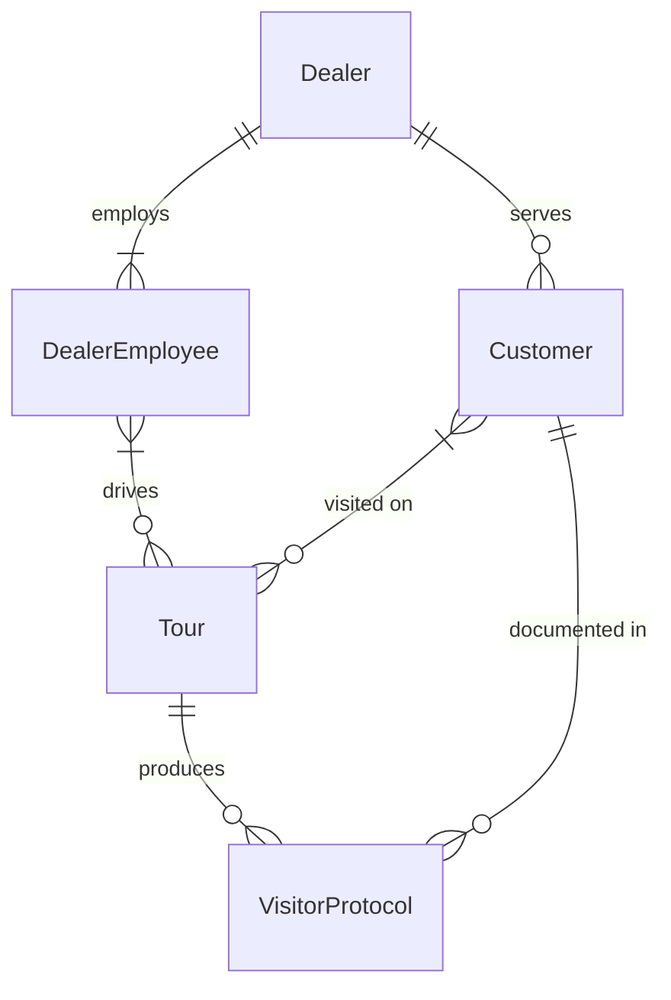

# TerraMax – Database Schema

Entity-relationship model of the TerraMax service, transcribed from the whiteboard
sketch ([`terramax-db-schema-whiteboard.jpg`](terramax-db-schema-whiteboard.jpg)).
A browser-viewable version is in [`terramax-db-schema.html`](terramax-db-schema.html).

## Relationships

| From           | Cardinality | To              | Meaning                                                   |
|----------------|-------------|-----------------|-----------------------------------------------------------|
| Dealer         | 1 : 1..n    | DealerEmployee  | A dealer has at least one employee.                       |
| Dealer         | 1 : 0..n    | Customer        | A customer belongs to exactly one dealer.                 |
| DealerEmployee | 1..n : 0..n | Tour            | A tour is run by one or more employees (many-to-many).    |
| Customer       | 1..n : 0..n | Tour            | A tour visits one or more customers (many-to-many).       |
| Customer       | 1 : 0..n    | VisitorProtocol | Each protocol is about exactly one customer.              |
| Tour           | 1 : 0..n    | VisitorProtocol | Each protocol is created during exactly one tour.         |

## Notes

- The whiteboard shows entities and cardinalities only; attributes are not yet defined.
- The two many-to-many relationships (`DealerEmployee`–`Tour`, `Customer`–`Tour`) need
  join tables in a relational implementation, e.g. `tour_employee` and `tour_customer`.
