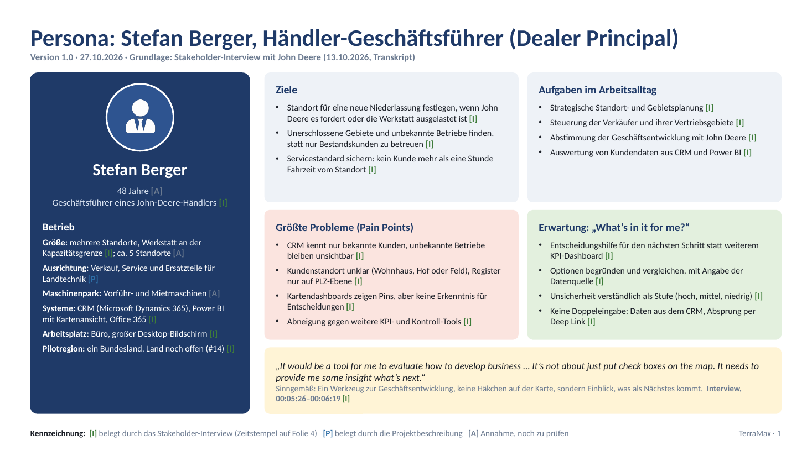
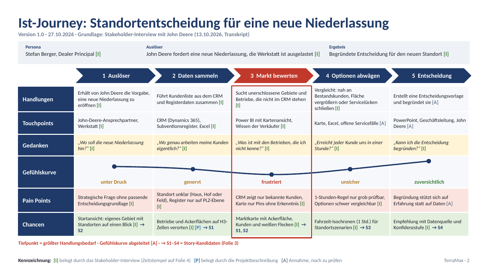

# Persona und User Journey: Dealer Principal

Ergebnis zu Issue #13. Grundlage ist das Stakeholder-Interview mit John Deere vom 13.10.2026 (Transkript) sowie die Spikes #1, #3, #4 und #5.

| Datei | Inhalt |
|---|---|
| [persona-journey-dealer-principal.pdf](persona-journey-dealer-principal.pdf) | Persona, Ist-Journey, Story-Kandidaten, Belege mit Zeitstempeln (4 Folien) |
| [persona-journey-dealer-principal.pptx](persona-journey-dealer-principal.pptx) | Bearbeitbare Quelldatei |

**Kennzeichnung:** [I] belegt durch das Stakeholder-Interview · [P] belegt durch die Projektbeschreibung · [A] Annahme, noch zu prüfen

## Persona

**Stefan Berger, Geschäftsführer eines John-Deere-Händlers (Dealer Principal)** [I]. Name, Alter und Betriebsgröße sind Annahmen [A].

- **Ziel:** Standort für eine neue Niederlassung festlegen, wenn John Deere es fordert oder die Werkstatt ausgelastet ist [I]
- **Servicestandard:** Kein Kunde mehr als eine Stunde Fahrzeit vom Standort [I]
- **Größter Pain Point:** Das CRM kennt nur bekannte Kunden, unbekannte Betriebe und unerschlossene Gebiete bleiben unsichtbar [I]
- **Erwartung:** Entscheidungshilfe mit Begründung und Datenquelle statt eines weiteren KPI-Dashboards [I]

> „It would be a tool for me to evaluate how to develop business … It needs to provide me some insight what's next.“ (Interview, 00:05:26–00:06:19)

Laut Interview gibt es eine zweite Persona für das MVP, den **Sales Professional** im Außendienst. Sie wird in einer eigenen Journey beschrieben.

## Ist-Journey: Standortentscheidung für eine neue Niederlassung

| Phase | Pain Point | Chance | Story |
|---|---|---|---|
| 1 Auslöser | Strategische Frage ohne passende Entscheidungsgrundlage | Startansicht mit eigenem Gebiet und Standorten | S2 |
| 2 Daten sammeln | Kundenstandort unklar, Register nur auf PLZ-Ebene | Betriebe und Ackerflächen auf H3-Zellen verorten | S1 |
| **3 Markt bewerten (Tiefpunkt)** | CRM zeigt nur bekannte Kunden, Karte nur Pins | Marktkarte mit Ackerfläche, Kunden und weißen Flecken | S1, S2 |
| 4 Optionen abwägen | 1-Stunden-Regel nur grob prüfbar | Fahrzeit-Isochronen für Standortszenarien | S3 |
| 5 Entscheidung | Begründung stützt sich auf Erfahrung | Empfehlung mit Datenquelle und Konfidenzstufe | S4 |

## Story-Kandidaten

Als Issues angelegt und mit #13 verknüpft:

- **S1 (#17):** Als Dealer Principal möchte ich mein Gebiet als H3-Raster mit der Ackerfläche je Zelle sehen, um zu erkennen, wo mein adressierbarer Markt liegt.
- **S2 (#18):** Als Dealer Principal möchte ich meine Standorte, Vertriebsgebiete und CRM-Kunden auf dieser Karte sehen, um Gebiete mit zu wenig Betreuung zu erkennen.
- **S3 (#19):** Als Dealer Principal möchte ich sehen, welche Gebiete mehr als eine Stunde Fahrzeit vom nächsten Standort entfernt liegen, um Standorte für eine neue Niederlassung zu bewerten.
- **S4 (#20):** Als Dealer Principal möchte ich zu jeder Empfehlung die Datenquelle und eine Konfidenzstufe sehen, um meine Entscheidung gegenüber John Deere begründen zu können.

## Offene Punkte

- Größe des Händlers (Anzahl Standorte, Mitarbeitende) mit John Deere klären
- Pilot-Bundesland festlegen (#14)
- Gewichtung der Standortkriterien: Nähe zu Kunden, Flächenabdeckung, offene Servicefälle
- Persona und Journey im Review mit dem Product Owner validieren
